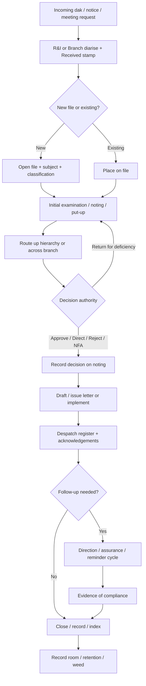

# National Assembly of Pakistan — Operations Research & Paperless System Requirements

**Document type:** Research findings + foundation requirements  
**Prepared for:** Design of a secure paperless office / file-processing system (Speaker’s Office first, expandable)  
**Date:** 20 October 2026  

---

## How to read this document

| Label | Meaning |
|-------|---------|
| **VERIFIED (NA)** | Stated in National Assembly of Pakistan public documents |
| **VERIFIED (Federal practice)** | Stated in Federal Secretariat Instructions / Rules of Business / Official Secrets / ETO / NITB e-Office materials — applies to federal government offices; **NA Secretariat is constitutionally distinct** but commonly follows similar office culture |
| **STATED NEED (NA consultation)** | From NA Technical Market Consultation for Speaker’s Office digital enablement (non-binding market exercise) |
| **INFERENCE** | Reasonable operational inference; not independently confirmed for NA |
| **ASSUMPTION / RECOMMENDATION** | Design choice for our system; not a claim about current NA practice |

**Important limitation:** A complete internal “file manual” for the National Assembly Secretariat is **not** published as a single public codebook. Parliamentary procedure is public (Rules of Procedure). Day-to-day **administrative file processing** is reconstructed from: NA job descriptions, organogram, R&I circular, federal Secretariat Instructions (the national standard for noting/dak), NITB e-Office practice, and the Speaker’s Office consultation package.

---

# PART A — Existing system (as verified)

## A1. Two layers of “operations” at the National Assembly

### A1.1 Parliamentary / House business — VERIFIED (NA)

Governed by the **Rules of Procedure and Conduct of Business in the National Assembly, 2007** (as amended; NA publishes updated editions on [na.gov.pk](https://www.na.gov.pk)).

Examples of what these Rules cover (not an admin office manual):

- Powers and functions of the **Speaker**
- Notices (questions, bills, motions, privileges)
- Committees, reports, minutes of dissent
- Debates / report of proceedings
- **Rule 282** — Report of proceedings  
- **Rule 283** — Custody of documents and records  
- **Rule 80** — Questions relating to the Secretariat are asked of the Speaker by communication, not as ordinary questions  
- Secretariat assistance so private members’ Bills are not rejected merely on technical grounds  

**Implication:** House records and parliamentary process are legally and institutionally separate from ordinary “office dak,” but both flow through the **Secretariat** under the Speaker’s oversight.

### A1.2 Secretariat / administrative office work — VERIFIED (NA) + VERIFIED (Federal practice)

The **National Assembly Secretariat** supports the Speaker, Members, committees, and House sittings. Public organograms ([OrganogramNA.pdf](https://na.gov.pk/uploads/OrganogramNA.pdf), older handbook layout) show:

- **Hon’ble Speaker** at the apex  
- **Secretary General** as head of Secretariat  
- Wings/branches such as: Administration, Services, Estate, Security, Finance, HRM, Record, Training, Discipline, Litigation, Legislation/Committees (in older charts), Media, IT, R&I (Receipt & Issue), Speaker’s Office (Principal Secretary / SPS / DS), Library & Research, etc.

**Job descriptions** published by NA ([job_description.pdf](https://www.na.gov.pk/uploads/content/job_description.pdf)) assign classic secretariat file duties to staff, including:

| Role (examples) | File-related duties (verified from JD text) |
|-----------------|--------------------------------------------|
| **Secretary** | Ensure cases submitted for Speaker’s consideration are complete; supervise session arrangements; Principal Accounting Officer |
| **Additional Secretary (Admin)** | Oversee administration wing policies/procedures; consistency of services |
| **Superintendent** | Direct Assistants on initial processing; put up cases with documents/rules and proposed action; track inward/outward movement; recording, indexing, weeding of files |
| **Assistant** | Process cases at initial stage; put up with relevant documents/rules and proposal; keep track of movement; recording/indexing/weeding; maintain files/registers |
| **UDC / clerks** | Orderly office record; place letters in designated files; retrieval |

**R&I discipline — VERIFIED (NA):** Establishment Branch circular (Aug 2024) directs all Sections/Branches to **diarise incoming dak** (internal or external) and affix a **Received** stamp showing From / By / Date / Time — citing loss and embarrassment from non-diarizing.

### A1.3 Speaker’s Office operational pain — STATED NEED (NA consultation)

The Technical Market Consultation package (Speaker’s Office digital enablement) states that work is currently handled through **separate files, registers, messages, emails and individual follow-up**, making it hard to see in one place:

- what was received  
- what is pending  
- what decision was taken  
- who is responsible  
- what needs the Speaker’s attention  

Desired capabilities explicitly include: file receipt→closure, directions with owners/due dates/evidence, meetings/visitors, schedule, searchable institutional memory, dashboards, Urdu+English, audit, RBAC, on-prem/sovereign data posture, human-reviewed AI only.

---

## A2. The classic Pakistani secretariat file lifecycle

**Source class:** VERIFIED (Federal practice) — *Secretariat Instructions* (Establishment Division, Edition 2021, with e-Office Instruction 76). NA staff JDs mirror the same verbs (put up, movement, recording, indexing, weeding). Treat as the **standard operating culture** unless NA issues conflicting local SOPs.

### A2.1 Receipt (dak) → diarising

1. Incoming paper/email/dak arrives (external ministry, MNA, public, internal branch).  
2. **R&I / branch** acknowledges and **diarises** (register entry).  
3. NA circular reinforces stamp: branch name, Received, From, By, Date, Time.  
4. Fresh receipts may be seen first by senior officers then sent down with instructions (federal pattern).

### A2.2 Opening / categorising a file

1. Decide whether receipt belongs on an **existing file** or needs a **new file**.  
2. Open file with subject heading; maintain **File Register**.  
3. Place **Paper Under Consideration (PUC)** on the correspondence side; noting on the noting side (classic split docket — INFERENCE that paper dockets still dominate where e-Office is not fully used).  
4. Attach relevant rules, precedents, previous papers.

### A2.3 Noting and “put up”

1. Junior officer (Assistant/SO level) examines PUC.  
2. If mere perusal suffices → brief suggestion for action (avoid paraphrasing PUC).  
3. If needed → concise note: background, facts, points for decision, proposal.  
4. Case is **put up** the hierarchy: Assistant → Superintendent → Section Officer → DS/JS/AS → Secretary / Speaker’s Office as required.  
5. Corrections at draft stage before putting up to seniors (Superintendent JD).

### A2.4 Inter-office consultation and movement

1. Files move with **movement tracking** (who has custody).  
2. Cross-Division consultation under Rules of Business / Secretariat Instructions.  
3. When returned from another office, prefer decision note over endless re-noting.  
4. **Classified** movement requires receipts at every custody transfer (Top Secret / Secret / Confidential handling booklet referenced by Instructions).

### A2.5 Decision, drafting, despatch

1. Competent authority records decision on noting sheet.  
2. Draft reply / order / letter prepared; typed; issued.  
3. **Despatch register**; action after despatch; copies on file.  
4. Level of approval may be indicated (“issues with approval of …”).

### A2.6 Recording, indexing, weeding, archive

1. Closed files **recorded** and **indexed**.  
2. Transferred to **record room** per retention.  
3. **Weeding** of files/registers on schedule.  
4. NA has a **Record Branch** on the organogram — VERIFIED (NA structure).

### A2.7 Checks on delays — VERIFIED (Federal practice)

- Monthly **arrears returns** by Section Officers.  
- Reminder ladder: UO/OM → demi-official → higher level + telephone.  
- Provincial references undisposed >1 month → bring to Secretary with reasons.  
- Public correspondence: acknowledge immediately; final reply after disposal.  
- Periodical officer meetings on pending cases; brief minutes of decisions only.

---

## A3. Security and confidentiality

| Topic | Status | Substance |
|-------|--------|-----------|
| Official Secrets Act, 1923 | VERIFIED | Unauthorised disclosure of official secrets is a criminal offence |
| Classification | VERIFIED (Federal practice) | Top Secret / Secret / Confidential; handled per *Security of Classified Matter in Government Departments*; separate diaries; custody receipts; limited hands; sealed covers / personal delivery |
| Computers/Fax | VERIFIED (Federal practice) | Classified matter not on unprotected fax; designated operators; access controls |
| Cabinet secrecy reminders | VERIFIED | 2024 Cabinet materials reaffirm prosecution for leakage of classified information |
| NA application | INFERENCE | Speaker’s Office and Secretariat handle politically sensitive material; consultation demands encryption, RBAC, audit, data sovereignty |

---

## A4. Digital / paperless baseline in Pakistan government

### A4.1 Legal recognition of electronic records — VERIFIED

**Electronic Transactions Ordinance, 2002 (ETO):**

- Electronic form shall not be denied legal recognition merely for being electronic  
- Writing / retention / signature requirements can be satisfied electronically (with integrity/accessibility conditions)  
- **Advanced electronic signatures** carry presumptions of authenticity/integrity  
- **Exclusions** (e.g. wills, certain property instruments, powers of attorney, negotiable instruments) — keep wet-ink pathways where law requires  

**Qanun-e-Shahadat** Art. 78-A: proof of electronic signature/document via security procedures.

### A4.2 NITB e-Office — VERIFIED (Federal digital practice)

National IT Board **e-Office** (MoITT/NITB):

- Electronic file creation, noting paras, forward/save, attachments, references  
- File / document / summary queues; e-Track; receive & despatch registers  
- Reminders; search; workflow; digital approval patterns  
- Org chart + employee designations required for configuration  
- Audit trails, backups, DR messaging in official descriptions  
- Maturity model / phased adoption; Instruction 76: Federal Ministries/Divisions to adopt e-Office at maturity level 4  

**INFERENCE for NA:** Adopting *identical* NITB e-Office vs a **bespoke Speaker’s Office platform that interoperates** is a procurement/architecture choice. The consultation asks for coexistence with NITB/NA systems via APIs — not necessarily replacing all parliamentary systems overnight.

---

## A5. Meetings, decisions, follow-up

| Channel | Verified behaviour |
|---------|-------------------|
| House / Committees | Rules: notices, agendas via Secretariat, committee reports with recommendations and minutes of dissent, presentation to Assembly |
| Secretariat management meetings | Federal Instructions: monthly/quarterly pending-case meetings; **brief minutes** of decisions |
| Speaker’s Office | STATED NEED: meeting requests, visitors, briefing notes, outcomes → action points → **directions tracker** |
| Government Assurances Committee | Rules provide institutional follow-up on assurances (parliamentary layer) |

---

## A6. Roles and authority (simplified map)

```
Speaker (constitutional / Rules authority)
    └── Principal Secretary / Speaker’s Office staff (put-up, diary, protocol, directions)
Secretary General (head of Secretariat; advises Chair; administers Secretariat)
    └── Additional / Joint / Deputy Secretaries (wings)
            └── Section Officers / Assistant Secretaries (branch heads)
                    └── Superintendents
                            └── Assistants / Clerks / R&I
DG IT / Record / Security / Finance (specialist control functions)
Members / Committees / Ministries (external originators of business)
```

**VERIFIED (NA):** hierarchy and branch names from organogram/JDs.  
**ASSUMPTION:** Exact financial/administrative delegation tables (who may approve what amount / what class of case) are internal and must be captured in workshops with NA before go-live.

---

## A7. End-to-end process (composite — labels mixed)



---

## A8. Bottlenecks and operational challenges

| Challenge | Evidence basis |
|-----------|----------------|
| Non-diarising of dak | VERIFIED (NA 2024 circular) |
| Fragmented tools (files + email + WhatsApp + personal follow-up) | STATED NEED (consultation) |
| Physical movement delays / missing files | VERIFIED problem statement in e-Office materials |
| Officer absence stalls files | VERIFIED (e-Office rationale) |
| No single view of Speaker pending work | STATED NEED |
| Classified leakage risk | VERIFIED (Official Secrets + Cabinet reminders) |
| Weak institutional memory / person-dependent retrieval | STATED NEED + classic registry risk (INFERENCE) |
| Dual language (Urdu/English) | STATED NEED |
| Over-noting / delay culture | VERIFIED (Instructions discourage unnecessary noting; arrears returns) |
| Incomplete put-ups to Speaker | VERIFIED (Secretary JD: cases must be complete) |

---

## A9. What we do **not** know from public sources (research gaps)

1. Exact NA-internal **file numbering** scheme and retention schedules.  
2. Whether NA Secretariat is on **NITB e-Office** fully, partially, or not for Speaker’s Office.  
3. Full list of **delegated financial/administrative powers**.  
4. Physical **peon book / dak book** SOPs inside Parliament House.  
5. Integration points with **Hansard**, questions database, committee systems (exist separately; details proprietary).  
6. Current **PKI / digital signature** provider used by NA (if any).  

These must be closed by stakeholder interviews before final configuration.

---

# PART B — Requirements foundation (for our paperless system)

## B0. Product intent

Build a **secure, bilingual (Urdu/English), role-based paperless office and file-processing platform** that:

1. Digitises the **secretariat file lifecycle** (receipt → noting → movement → decision → despatch → archive).  
2. Adds **Speaker’s Office** command capabilities (directions, meetings, diary, dashboards).  
3. Remains usable by **non-technical staff** (clerks, assistants, PS).  
4. Is **legally defensible** under ETO + Official Secrets culture (integrity, attribution, audit).  
5. Can start as Speaker’s Office pilot and expand to other Secretariat wings without rewrite.

**Out of scope for v1 (unless explicitly prioritised):** full House voting systems, live Hansard production, citizen portal, full PAC audit casework.

---

## B1. Actors & permissions (RBAC)

| Actor | Typical actions | Notes |
|-------|-----------------|-------|
| Registry / R&I clerk | Diarise, stamp metadata, scan, open file, despatch | High volume, simple UI |
| Assistant / Superintendent | Noting paras, put-up, attach rules, track movement | Append-only notes |
| Section Officer / Branch head | Approve put-up, route, return, escalate | Custody holder |
| DS / JS / AS | Decide within delegation, inspect arrears | Dashboards |
| Secretary General | High-level disposal, Speaker put-up quality | |
| Speaker / authorised office | Final decisions, directions, diary | Highest sensitivity |
| Protocol / Meetings cell | Visitors, meetings, briefs | |
| Record officer | Close, index, retention, weed proposals | |
| DG IT / Admin | Users, roles, audit verify, config | Separation of duties |
| Auditor / read-only oversight | View audit (as policy allows) | No mutate |

**Requirements**

- R-AUTH-01: Unique named accounts; no shared logins in pilot/production.  
- R-AUTH-02: MFA for all roles that see Confidential or Speaker material.  
- R-AUTH-03: Least privilege; object-level ACL on files by classification + role + grant.  
- R-AUTH-04: Delegation / acting charge with time box and audit.  
- R-AUTH-05: Separation: admin cannot silently alter noting/decision content.

---

## B2. Functional requirements by domain

### B2.1 Daily file management

| ID | Requirement | Priority |
|----|-------------|----------|
| R-FILE-01 | Register incoming/outgoing with diary number, date/time, from/to, channel (post/email/hand/portal) | Must |
| R-FILE-02 | Open new file or attach to existing by subject search | Must |
| R-FILE-03 | Metadata: subject, subject area, priority, classification, tags, related files | Must |
| R-FILE-04 | Attachments with virus scan, size limits, checksum, version | Must |
| R-FILE-05 | Full-text search (EN/UR) with permission filtering | Must |
| R-FILE-06 | Status model: Received, Under examination, Awaiting receipt, In progress, Awaiting decision, Returned, Issued/Despatched, Closed, Archived | Must |
| R-FILE-07 | Current **holder** (custody) distinct from **assignee** (pending receipt) | Must |
| R-FILE-08 | Incomplete put-up checklist before Speaker presentation | Should |

### B2.2 File movement

| ID | Requirement | Priority |
|----|-------------|----------|
| R-MOVE-01 | Route to named user/role/branch with procedure text + optional due date | Must |
| R-MOVE-02 | Acknowledge receipt to transfer custody | Must |
| R-MOVE-03 | Return with mandatory remarks (≥ threshold) | Must |
| R-MOVE-04 | Multi-step route templates (branch chains) | Should |
| R-MOVE-05 | CC / info mark without transferring custody | Should |
| R-MOVE-06 | Movement history always visible (journey) | Must |
| R-MOVE-07 | Bulk “where is my file” by diary/subject | Must |

### B2.3 Noting & approvals

| ID | Requirement | Priority |
|----|-------------|----------|
| R-NOTE-01 | Append-only numbered noting paras; no silent edit/delete | Must |
| R-NOTE-02 | Note kinds: Note, Put-up, Observation, Decision, Draft | Must |
| R-NOTE-03 | Decision types: Approve, Reject, Return, Direction, Refer, NFA | Must |
| R-NOTE-04 | Capture deciding authority, timestamp, optional advanced e-sign | Must |
| R-NOTE-05 | Draft letters linked to file; despatch with reference number | Must |
| R-NOTE-06 | Escalation path when overdue or blocked | Must |

### B2.4 Directions & follow-ups (Speaker focus)

| ID | Requirement | Priority |
|----|-------------|----------|
| R-DIR-01 | Direction linked to file/meeting/subject | Must |
| R-DIR-02 | Owner + due date required | Must |
| R-DIR-03 | Reminders before due; overdue status | Must |
| R-DIR-04 | Evidence = text + file; verify/return by issuer | Must |
| R-DIR-05 | Dashboard: pending / overdue / closed | Must |

### B2.5 Meetings & decisions

| ID | Requirement | Priority |
|----|-------------|----------|
| R-MTG-01 | Meeting/visitor request intake | Must |
| R-MTG-02 | Briefs/attachments on meeting record | Must |
| R-MTG-03 | Minutes / action points | Must |
| R-MTG-04 | Action points spawn Directions | Must |
| R-MTG-05 | Schedule conflict detection | Should |

### B2.6 Notifications

| ID | Requirement | Priority |
|----|-------------|----------|
| R-NTF-01 | In-app notifications for route, return, direction, overdue | Must |
| R-NTF-02 | Optional email/SMS if approved channel exists | Should |
| R-NTF-03 | Reminder policy configurable per matter type | Should |

### B2.7 Audit & accountability

| ID | Requirement | Priority |
|----|-------------|----------|
| R-AUD-01 | Immutable audit of create/view/download/route/note/decide/despatch/unlock | Must |
| R-AUD-02 | Hash-chained or WORM-style integrity verification for auditors | Should |
| R-AUD-03 | Export audit pack for a file or date range | Must |

### B2.8 Security & confidentiality

| ID | Requirement | Priority |
|----|-------------|----------|
| R-SEC-01 | Classifications: at least Public / Internal / Confidential (/ Secret if NA requires) | Must |
| R-SEC-02 | Confidential: encryption at rest; unlock/grant model; TTL; download logging | Must |
| R-SEC-03 | No classified content to unapproved external AI/training | Must |
| R-SEC-04 | TLS; secrets in vault; hardened deployment | Must |
| R-SEC-05 | Watermark + reason-for-access on sensitive downloads | Should |

### B2.9 Digital signatures & authenticity

| ID | Requirement | Priority |
|----|-------------|----------|
| R-SIG-01 | Support ETO-compatible electronic / advanced signatures for decisions & despatch | Should (Must for production legal sign-off) |
| R-SIG-02 | Preserve signature certificate metadata + document hash | Must if R-SIG-01 |
| R-SIG-03 | Wet-ink scan attachment path for excluded document types | Must |

### B2.10 Reporting & monitoring

| ID | Requirement | Priority |
|----|-------------|----------|
| R-RPT-01 | Dashboards: my pendency, branch pendency, Speaker queue, overdue | Must |
| R-RPT-02 | Arrears-style monthly export | Should |
| R-RPT-03 | Turnaround time analytics by branch/type | Could |

### B2.11 Archive & exit

| ID | Requirement | Priority |
|----|-------------|----------|
| R-ARC-01 | Close → record → retention class → archive | Must |
| R-ARC-02 | Full export (metadata + binaries + audit) for exit/portability | Must |
| R-ARC-03 | Weed proposals with dual control | Should |

### B2.12 Usability (non-technical staff)

| ID | Requirement | Priority |
|----|-------------|----------|
| R-UX-01 | Urdu + English UI; mixed-script content | Must |
| R-UX-02 | Large clear actions: Receive, Put up, Route, Return, Despatch | Must |
| R-UX-03 | Guided register form with required fields only | Must |
| R-UX-04 | Offline-hostile: assume online on-prem; clear error states | Must |
| R-UX-05 | Training mode / sandbox with synthetic data | Should |

---

## B3. Exception & error handling (must design explicitly)

| Scenario | System behaviour |
|----------|------------------|
| Missing attachments / incomplete put-up | Block Speaker presentation; return with checklist |
| Rejected / returned file | Status Returned; remarks mandatory; notify prior holder |
| Wrong branch / mis-diarised | Correct with audited amendment; keep original diary trail |
| Urgent / immediate | Priority flag + SLA clock + bypass template with audit |
| Officer on leave | Delegation / reassign holder; auto-notify |
| Conflicting decisions | New decision supersedes with link to prior; never delete |
| Duplicate registration | Detect similar subject/sender/date; warn before open |
| Unlock failed / vault lockout | Limited retries; admin break-glass with dual control |
| Despatch failure | Keep Draft; retry; do not mark Issued until confirmed |
| System outage | Read-only failover if possible; paper contingency SOP documented |
| AI suggestion wrong | Never auto-apply; human accept/edit/reject logged |

---

## B4. Non-functional requirements

| ID | Requirement |
|----|-------------|
| NFR-01 | On-prem or Pakistan sovereign cloud as approved; data residency disclosed |
| NFR-02 | RPO/RTO targets agreed in runbook; tested restore |
| NFR-03 | Concurrent users: pilot ≥ 50; scale path to Secretariat-wide |
| NFR-04 | Accessibility: keyboard usable; readable contrast; optional larger text |
| NFR-05 | VAPT before production; vulnerability SLAs |
| NFR-06 | Interoperability: documented APIs for identity, calendar, future NITB/NA systems |
| NFR-07 | Configurability: org chart, route templates, retention — not hard-coded only for one wing |

---

## B5. Phased delivery (recommended)

| Phase | Scope | Exit criteria |
|-------|-------|---------------|
| **Pilot 0** | Speaker’s Office: files, vault, route/return/note, directions, meetings lite, audit, MFA | Path A/B acceptance + consultation demo scenario |
| **Pilot 1** | R&I despatch registers, multi-step routes, e-sign, arrears reports | Two branches live |
| **Scale** | Additional wings; Record Branch retention; SSO | Interop + training complete |
| **Extend** | Questions/speeches/media modules as separately approved | Per consultation §3.5 |

---

## B6. Alignment with current `gov-office-workflow` codebase

Already strong against Pilot 0: matters, vault, route/ack/return, noting, directions+evidence file, journey/audit, meetings/schedule modules, smoke tests, pilot env flags.

**Still required for consultation-grade / real NA fit:**

- True R&I receive/despatch registers & stamp metadata model  
- Multi-desk route templates & acting charge  
- Advanced e-sign / PKI  
- Clearance matrix beyond shared file password  
- Record/retention/weeding workflows  
- SSO / NA identity  
- Full bilingual UX polish  
- Formal VAPT + export drill  

---

## B7. Source list (research)

1. Rules of Procedure and Conduct of Business in the National Assembly, 2007 (NA publications / uploads).  
2. NA Secretariat organogram (na.gov.pk OrganogramNA.pdf).  
3. NA job descriptions (na.gov.pk job_description.pdf).  
4. NA Establishment circular on diarising dak (Aug 2024).  
5. Secretariat Instructions, Edition 2021 (Establishment Division) — noting, delays, classified, e-Office Inst. 76.  
6. Rules of Business, 1973 (as amended) — transaction of government business.  
7. Official Secrets Act, 1923; Cabinet classified-matter guidance.  
8. Electronic Transactions Ordinance, 2002; Qanun-e-Shahadat Art. 78-A.  
9. NITB / MoITT e-Office project descriptions and user manuals.  
10. NA Technical Market Consultation — Speaker’s Office digital/AI enablement (local project package).  

---

## B8. Immediate next steps (after this document)

1. **Stakeholder workshop** with Speaker’s Office + R&I + Record + IT to close research gaps (numbering, retention, e-Office status, delegation).  
2. Convert B2 tables into a **tracked backlog** (epics → stories) mapped to modules.  
3. Confirm deployment topology (on-prem NA vs NITB-linked).  
4. Run Pilot 0 acceptance against consultation §6 demonstration scenario using synthetic data only.  

---

*End of research & requirements foundation.*
